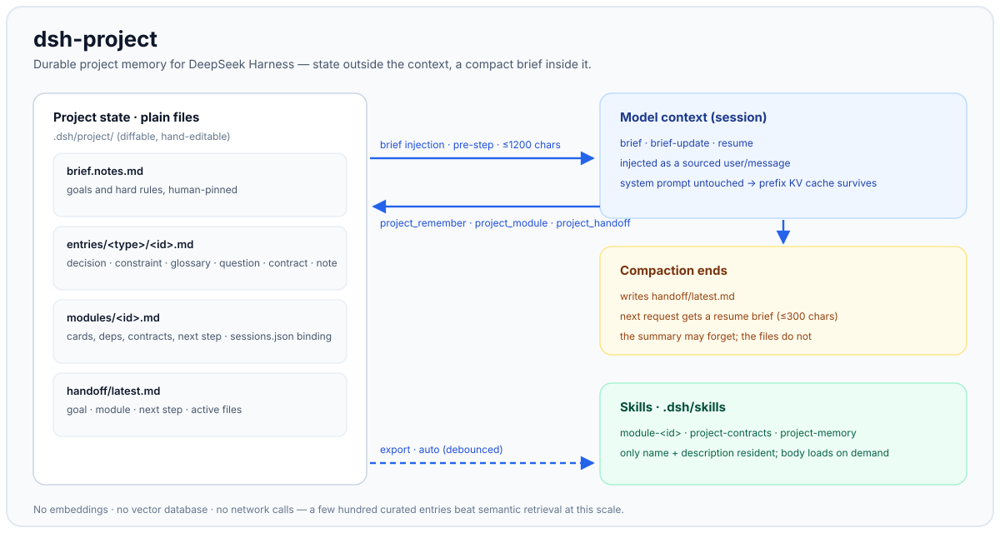

# dsh-project-control

[](https://github.com/echothesky/dsh-project-control/actions/workflows/check.yml)
[](https://www.npmjs.com/package/dsh-project-control)
[](LICENSE)

Durable project memory and modular-development workflow for [DeepSeek Harness](https://www.deepseek.com/harness/).

Long sessions hit the context limit; compaction keeps a generic summary and drops
the decisions, constraints and open questions that actually drive the work. New
sessions start cold. Different modules compete for one context window.

`dsh-project-control` keeps that state **outside** the model context — as plain files in
your repository — and injects back only a compact brief:

- a **layered brief** (project + module) before each request, budgeted in
  characters (CJK-safe, no token heuristics);
- a **durable store** of decisions, constraints, glossary, questions and
  contracts, written by the model through one tool and fetched by keyword;
- **compaction handoff**: a resume snapshot is written when a compaction ends and
  a short resume brief is injected on the next request;
- **modules**: cards, session binding, contracts with breaking-change notices,
  and one-command isolated sessions (optionally a Git worktree);
- **on-demand skills**: export the store as `.dsh/skills/*/SKILL.md`, so detail
  costs almost no context until it is needed;
- a **Web board** tab listing entries, filters, bodies and the latest handoff.

No embeddings, no vector database, no network calls: a few hundred entries are
handled better by exact keyword matching plus a small always-on brief.

## Demo



<!-- Recording placeholder: drop a short screen recording at docs/assets/demo.gif and embed it above the diagram. -->

## Install

### From the Harness UI

Settings → Plugins → Add plugin. With an npm release, search
`dsh-project-control`; otherwise install from a local directory or Git URL
below.

### CLI

```sh
# local checkout (the plugin_manager target is an absolute directory)
dsh plugin --profile web add /absolute/path/to/dsh-project

# npm release (`dsh-project` itself is taken by an unrelated package)
dsh plugin --profile web add dsh-project-control

# Git (pnpm installs the package from the repository)
dsh plugin --profile web add git+https://github.com/echothesky/dsh-project-control.git
```

The repository root is the plugin package (`dsh.bundle.patch` + `dsh.client`),
so a directory install links the checkout and picks up local edits.

> **One restart after the first client load.** `dsh-client-modules` caches each
> package's manifest per `(baseUrl, loader name)` for the Host lifetime. After
> installing this plugin for the first time, restart the app once so the
> "Project memory" tab joins the boot graph. Later host-side edits reload without
> a restart; client bundle edits need only a page refresh.

## Quick start

```text
# ask the agent to remember something durable
"记住：本项目一律用 pnpm，不用 npm"        → project_remember(type: "constraint", ...)

# later, in any session
"上次为什么选了这个方案？"                 → project_recall(query: "方案")
```

Human commands:

```text
/project                 show store status and the current module binding
/project export all      regenerate .dsh/skills
/handoff <next step>     write a resume snapshot
/module list             list modules and their binding
/module use docs         bind this session to a module
/module open docs --worktree   new session in an isolated Git worktree
```

## Storage

Everything lives under `<projectRoot>/.dsh/` and is plain Markdown/JSON — easy to
review, diff, version and hand-edit:

```text
.dsh/project/
├── brief.notes.md          # optional human-pinned goals and hard rules
├── entries/<type>/<id>.md  # decision | constraint | glossary | question | contract | note
├── modules/<id>.md         # module card: path/owner/status/deps/goal/contract/next step
├── sessions.json           # explicit session -> module bindings
├── handoff/latest.md       # resume snapshot
├── catalog.json            # derived index, rebuildable
└── brief.md                # human-readable mirror of the current brief

.dsh/skills/                # generated, on demand
├── module-<id>/SKILL.md
├── project-contracts/SKILL.md
└── project-memory/SKILL.md
```

`projectRoot` is the nearest ancestor containing `.git` (or an existing
`.dsh/project`); without either, the session working directory is used.

## How it works

### Brief injection

Before a step, the plugin renders the brief and appends it as a sourced
`user/message` (`source.kind = "dsh-project"`) through `agent/pre-step`. The
message is logged, replays and compacts like ordinary history; the system prompt
is never rewritten, so the KV-cache prefix stays reusable. Each injection
carries a digest, and a resumed session that already shows the same digest is not
injected again. Failures degrade to no injection.

### Modules and binding

A session binds to a module by, in order:

1. explicit override (`/module use <id>`, stored in `sessions.json`);
2. the longest module `path` containing the session cwd (durable in the session
   header, restored by resume/fork);
3. project level (unbound) — the "integration session".

Bound sessions get the module layer of the brief; unbound sessions get the
project layer, the module map and every breaking contract.

### Contracts

A contract is an ordinary entry with `type: contract` and status `proposed`,
`active` or `breaking`. A breaking contract owned by a bound module — or by one
of its `deps` — surfaces a short notice in the brief and in the handoff.

### Compaction handoff

On `compaction/end` the plugin writes `handoff/latest.md` (goal, module, next
step, contracts, open questions, recent decisions, active files, last
instruction) and marks the session for a resume brief. A periodic handoff
refreshes the file every `handoffEveryTurns` turns.

### Skills and worktrees

`project_export` writes deterministic `SKILL.md` files; the skill filesystem
provider watches its roots, so a new export joins the model catalog on the next
request. Exports refresh automatically after writes (debounced).

With `worktree: true`, a module session is opened in a fresh Git worktree
(branch `dsh-<module>-<stamp>`); project memory is shared through a `.dsh`
directory junction, with a snapshot-copy fallback. Cleanup is manual:
`git worktree remove --force <path>` and `git branch -D <branch>`.

## Configuration

| Field | Default | Meaning |
|---|---|---|
| `maxBriefChars` | `1200` | Brief budget in characters (not tokens) |
| `maxRecallHits` | `5` | Default `project_recall` limit (1–10) |
| `resumeBriefChars` | `300` | Resume brief budget after compaction |
| `autoHandoff` | `true` | Refresh the handoff every `handoffEveryTurns` turns |
| `handoffEveryTurns` | `10` | Turn interval for the periodic handoff |
| `autoExport` | `true` | Re-export skills after writes |
| `autoExportDelayMs` | `1500` | Debounce window (200–10000 ms) |
| `readOnly` | `false` | Refuse writes from tools |

## Repository layout

```text
index.js            Host half: injection, store, tools, commands, HTTP API
client.js           Browser half: the "Project memory" conversation tab
cordis.patch.yml    Bundle patch that inserts the plugin row
locale/en.json      Plugin Manager metadata (English)
locale/zh.json      Plugin Manager metadata (Chinese)
icon.svg            Plugin icon
docs/               Design notes and staged verification records
CHANGELOG.md
LICENSE
```

## Development

```sh
node --input-type=module --check < index.js
node --input-type=module --check < client.js
node -e "JSON.parse(require('fs').readFileSync('package.json','utf8'))"
```

Install a local checkout with the Harness plugin manager (`install_bundle` on the
absolute directory), then toggle the bundle off/on to reload Host code.

Verification records: `docs/P0-verification.md`, `P1-`, `P2-`, `P0.5-`, `P3-`,
`P4-worktree-verification.md`; design: `docs/dsh-project-design.md`; release
notes: `docs/RELEASE-0.2.0.md`.

## Known limitations

- Contracts are free text; breaking-change propagation follows the module `deps`
  declaration, not an import graph.
- Worktree cleanup is manual, and the Git CLI fallback is used when the
  `worktrees` service is not composed.
- File access uses Node `fs/promises` on the project directory rather than
  `ctx.fs` sandbox policies.
- Direct edits under `.dsh/project/` do not trigger automatic export.
- Without a `.git` marker the skill root falls back to the session cwd, so skills
  exported from a subdirectory session may not be discovered.
- Test sessions created during development are not deleted automatically.

## License

MIT — see [LICENSE](LICENSE).
